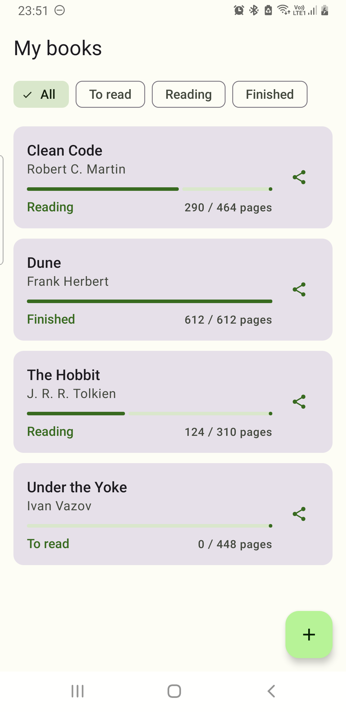
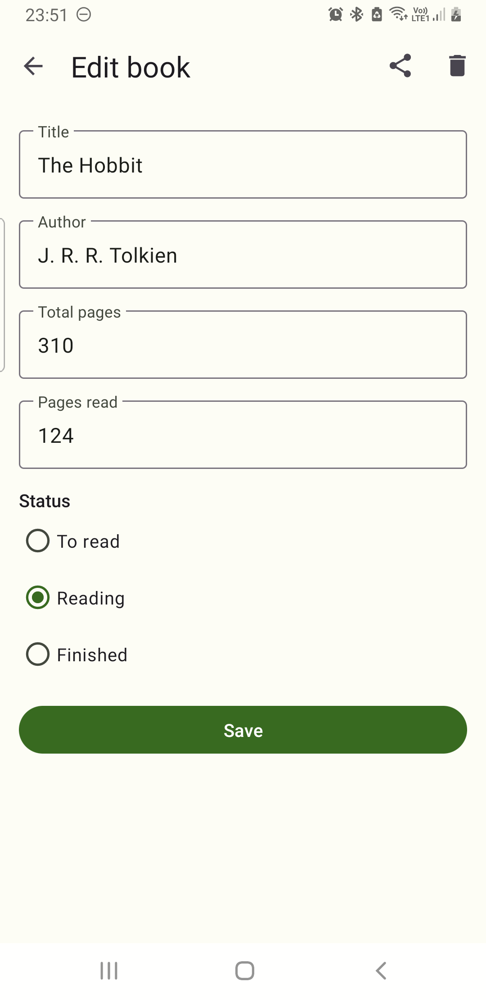
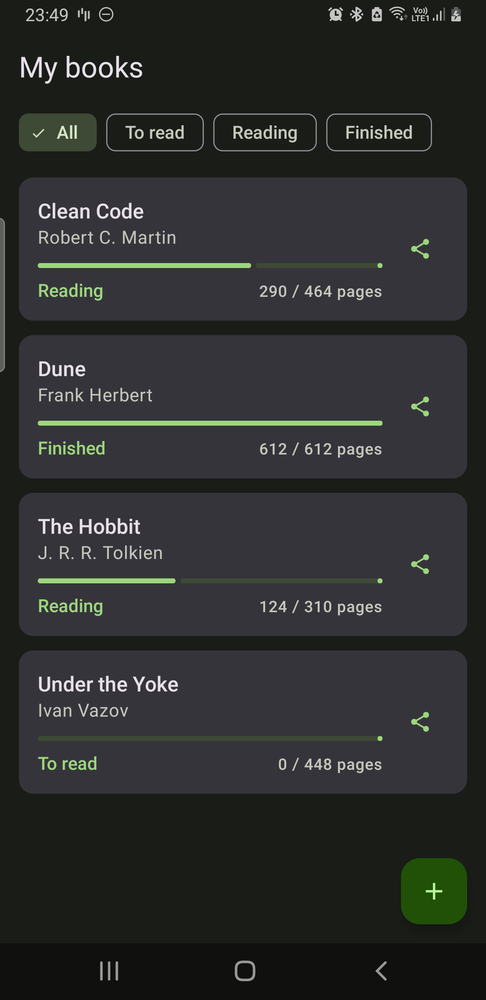

# BookShelf

Курсов проект по дисциплината „Мобилни приложения“, ФМИ, ПУ „Паисий Хилендарски“.

**Автор:** Емил Славов, фак. № 2401321060, специалност „Софтуерно инженерство“

## Идея

BookShelf е личен читателски дневник. Потребителят записва книгите, които иска да прочете, отбелязва докъде е стигнал и вижда напредъка си в проценти. Всяка книга може да бъде споделена с приятел като кратко текстово съобщение през произволно приложение на телефона.

## Как работи

Началният екран показва списък с всички книги, подредени по заглавие. Всяка книга има заглавие, автор, брой страници, прочетени страници и статус: „За четене“, „Чета“ или „Прочетена“. С филтрите над списъка се показват само книгите с избран статус. Бутонът „+“ отваря форма за нова книга, а докосване на книга отваря същата форма за редакция. Формата проверява данните и показва грешка под съответното поле. Книга се изтрива с плъзгане встрани в списъка (с възможност за отмяна) или от менюто на екрана за редакция. Бутонът за споделяне изпраща текст според статуса на книгата. Данните се пазят в локална база данни Room и остават след рестартиране на приложението. Приложението работи изцяло офлайн и не изисква разрешения.

## Архитектура

Приложението следва **MVVM** с **Repository** слой и ръчно инжектиране на зависимости.

```
UI (Fragment + ViewBinding)
        │  StateFlow<UiState>
ViewModel (BookListViewModel, BookEditViewModel)
        │
BookRepository (интерфейс) ── RoomBookRepository
        │
Room (BookDao, BookEntity, BookDatabase)
```

| Пакет | Съдържание |
|---|---|
| `ui.list` | Списък с книги: `BookListFragment`, `BookListViewModel`, `BookAdapter` |
| `ui.edit` | Форма за добавяне и редакция: `BookEditFragment`, `BookEditViewModel` |
| `ui.common` | Текстове за статуси и грешки, Share Intent |
| `domain` | Модел `Book`, валидация `BookValidator`, `ShareTextFormatter` |
| `data` | `BookRepository`, `RoomBookRepository`, Room класове |
| `di` | `AppContainer`, който създава базата и хранилището |

- **Dependency Injection:** `AppContainer` се създава в `BookShelfApp`. ViewModel-ите получават `BookRepository` през конструктора си чрез `ViewModelProvider.Factory`, затова в тестовете се подменя с `FakeBookRepository`.
- **Състояние:** всеки ViewModel излага един `StateFlow` с неизменяем `UiState`. Фрагментите го наблюдават с `repeatOnLifecycle(STARTED)`.
- **Навигация:** Navigation Component с една Activity и два фрагмента.

| Технология | Версия |
|---|---|
| Kotlin (вграден в AGP) | 2.x |
| Android Gradle Plugin | 9.3.3 |
| Min SDK / Target SDK | 24 / 37 |
| Room | 2.8.5 |
| Navigation | 2.10.2 |
| Lifecycle (ViewModel) | 2.11.0 |
| Material Components (Material 3) | 1.14.0 |

## Потребителски поток

1. Потребителят отваря приложението и вижда списъка с книги или съобщение, че списъкът е празен.
2. Натиска „+“, попълва заглавие, автор и брой страници и натиска „Запази“.
3. Новата книга се появява в списъка с лента за напредък.
4. Докосва книгата, променя прочетените страници или статуса и запазва.
5. Филтрира списъка по статус с бутоните над него.
6. Споделя книга с бутона за споделяне.
7. Изтрива книга с плъзгане встрани и при нужда отменя изтриването.

## Стъпки за стартиране

1. Клонирайте хранилището:
   ```
   git clone https://github.com/EmilSlvavov/MobileApps2025-2401321060.git
   ```
2. Отворете папката в Android Studio и изчакайте синхронизацията на Gradle.
3. Стартирайте конфигурацията `app` на емулатор или устройство с Android 7.0 (API 24) или по-нова версия.

Полезни команди:

| Команда | Действие |
|---|---|
| `./gradlew assembleDebug` | Изгражда debug APK |
| `./gradlew testDebugUnitTest` | Изпълнява unit тестовете |
| `./gradlew createDebugUnitTestCoverageReport` | Отчет за покритието в `app/build/reports/coverage` |
| `./gradlew connectedDebugAndroidTest` | Изпълнява Espresso теста на свързано устройство |
| `./gradlew ktlintCheck detekt` | Проверка на стила и статичен анализ |

## Тестови акаунти

Приложението не използва вход с потребител и не са необходими тестови акаунти. Всички данни се пазят локално на устройството.

## Скрийншотове

| Списък | Форма | Тъмна тема |
|---|---|---|
|  |  |  |

## APK

Готовият файл за инсталиране е в хранилището: [apk/app-release.apk](apk/app-release.apk)
